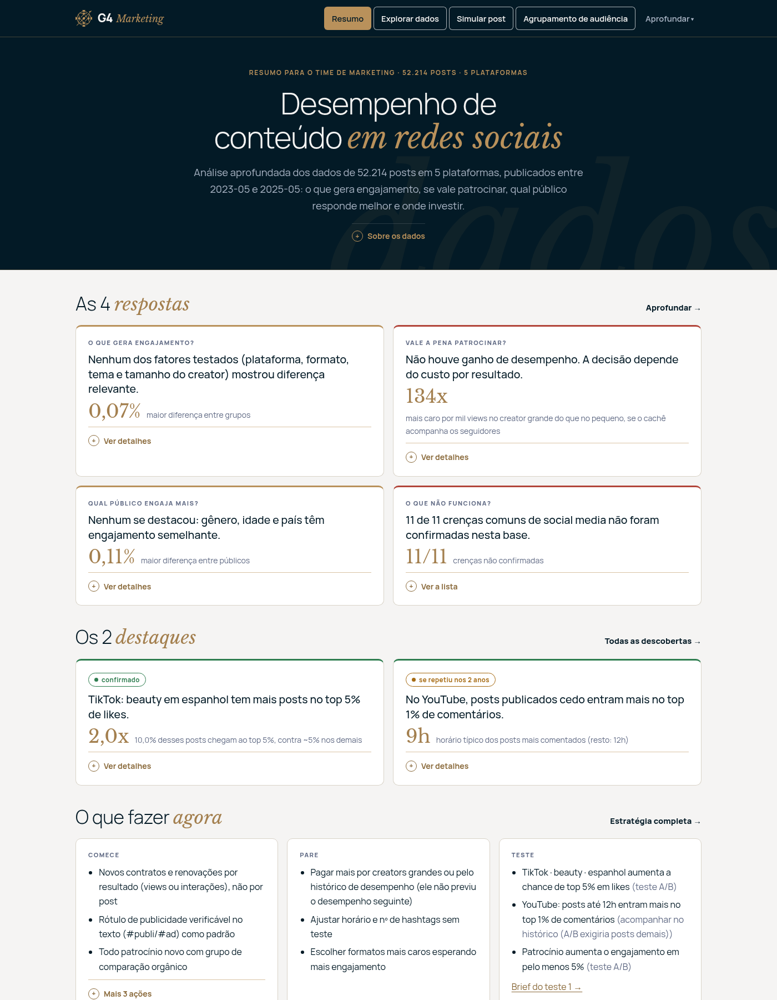
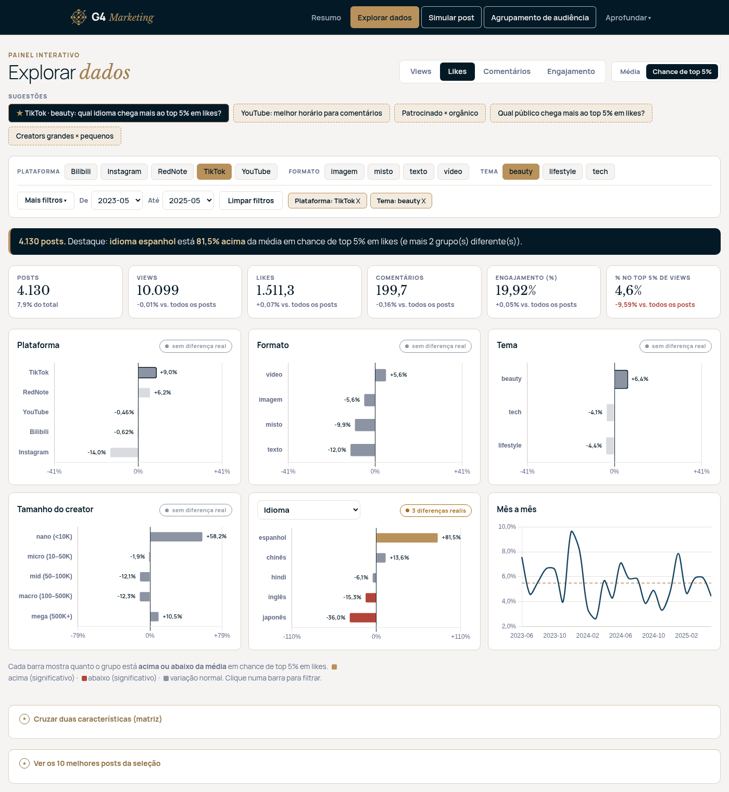
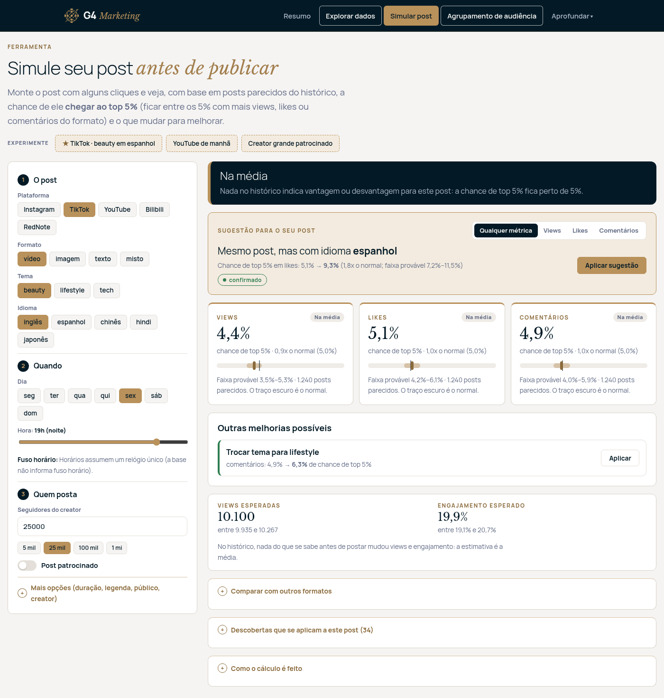

# Submissão — Rafael — Challenge 004

## Sobre mim

- **Nome:** Rafael
- **LinkedIn:** https://www.linkedin.com/in/rafaelcostaf/
- **Challenge escolhido:** 004 — Estratégia Social Media

---

## Executive Summary

Estruturei o projeto em etapas, organizando o repositório, preparando o dataset e definindo instruções específicas para análise, modelagem, validação e revisão independente dos resultados. A análise mostrou que o dataset é sintético e que as métricas de engajamento são essencialmente independentes das características dos posts, fazendo com que diferenças entre formatos, plataformas, creators e patrocínio sejam, em sua maioria, ruído. A recomendação principal é a **contratação de creators por resultado, não por post** (ex.: pagar creators por mil views ou por interação, medir todo patrocínio contra um grupo orgânico e testar antes de mudar a combinação.)

---

## Solução

### Abordagem

1. **Organização.** Baixei o dataset e criei instruções para cada tipo de tarefa ([`instructions/`](instructions/)), uma pasta de achados ([`knowledge/`](knowledge/)) e um registro de decisões ([`DEVELOPMENT_PROCESS.md`](DEVELOPMENT_PROCESS.md)).
2. **Entender os dados antes de concluir.** A EDA mostrou que a base é sintética. O foco passou a ser separar sinal de ruído.
3. **Revisores independentes.** Agentes separados, sem o contexto da análise, conferiram os achados contra a descrição do dataset e a entrega contra os requisitos.
4. **Rigor estatístico.** Correção para muitos testes, comparação de posts parecidos, efeito mínimo detectável, validação temporal e efeitos plantados que o método precisa encontrar.
5. **Produto.** Site com a identidade G4, organizado por perguntas de negócio.
6. **Simplificação.** Cortei textos e métricas em excesso e deixei só o que o time de marketing usa.
7. **Revisão final** contra os requisitos do desafio.

### Resultados / Findings

**O que construí:** um site que o time usa sem analista. Com os dados da empresa, basta trocar o CSV e rodar `social-web --rebuild`.

<p>



</p>

Depois de [rodar](#como-rodar), abra http://127.0.0.1:8000. O menu do topo tem 4 páginas principais e o menu "Aprofundar", com os detalhes.

| Página | O que mostra | Quando usar |
|---|---|---|
| **Resumo** | As respostas às 4 perguntas do desafio, os 2 padrões que merecem teste e uma lista do que começar, parar e testar | Para entender o resultado em 2 minutos |
| **Explorar dados** | Painel com filtros (plataforma, formato, tema, período…). Gráficos mostram quanto cada grupo fica acima ou abaixo da média, e um selo indica se a diferença é real ou acaso | Para tirar uma dúvida própria, ex.: "vídeo vai melhor no TikTok?" |
| **Simular post** | Você descreve um post (plataforma, formato, tema, idioma, dia, hora, creator). A página mostra a chance de ele ficar entre os 5% com mais views, likes ou comentários e sugere uma mudança que aumentaria essa chance | Antes de publicar ou aprovar um post |
| **Agrupamento de audiência** | Junta perfis de público (idade × gênero × país) que consomem conteúdo parecido e mostra o que cada grupo consome a mais. Um selo diz se os grupos são confiáveis o bastante para segmentar campanhas (nesta base, não são) | Para definir segmentos de público |
| **Aprofundar** → 4 perguntas, Estratégia, Descobertas, Auditorias, Como chegamos lá | Respostas com gráficos, as ações com o motivo de cada uma, os grupos fora da média com nível de evidência, os riscos da carteira (rótulo de publicidade, nicho, idioma) e o método | Para conferir o porquê de uma recomendação |

Cada número do site é reproduzível: o Docker falha se algum valor divergir da referência, e há 131 testes automatizados.

**O que encontrei** (52.214 posts, 5 plataformas, mai/2023 a mai/2025):

| Pergunta | Resposta | Dado |
|---|---|---|
| O que gera engajamento? | Nada que o time controla | 450 combinações testadas, nenhuma com efeito real; maior diferença: 0,07% |
| Patrocínio funciona? | Não melhora o desempenho; a decisão é de preço | Patrocinado engaja igual ao orgânico (+0,008%). Pagando por seguidor, o creator mega custa **~134x mais por mil views** que o nano |
| Que público engaja mais? | Nenhum | Gênero, idade e país engajam igual em 36 contextos |
| O que não funciona? | 11 de 11 crenças de mercado | Ex.: mais seguidores não trazem mais views (correlação 0,005) |
| Vale pagar a mais por creator "campeão"? | Não | Só 8,8% dos melhores do 1º ano continuaram entre os melhores no 2º (acaso: 10%) |
| Há algum padrão real? | Um, para testar | TikTok · beauty · espanhol: 10% dos posts entre os 5% com mais likes, contra 4,9% no resto, nos 2 anos |
| Riscos da carteira | Independem do engajamento | 47% dos patrocínios sem rótulo claro de publicidade; 60% fora do nicho do creator; só 22% dos posts no idioma do mercado |

<details>
<summary><b>O que uma IA diria × o que os dados mostram</b></summary>

| "Insight" típico | O que os dados mostram |
|---|---|
| "Bilibili · vídeo · lifestyle · micro engaja mais: concentre o investimento." | Foi a maior diferença entre 450 grupos (+0,5%), mas some quando se desconta o acaso |
| "Creators maiores dão mais alcance." | Seguidores e views não têm relação (correlação 0,005) |
| "Vídeo engaja mais: migre o mix." | Vídeo engaja 0,03% menos; diferença nula |
| "Publique à noite." | Views 0,01% menores; diferença nula |
| TikTok · beauty · espanhol | Único padrão que resistiu ao acaso: vai para teste A/B |

</details>

Relatório completo: [`docs/respostas.md`](docs/respostas.md) · achados por tema: [`knowledge/`](knowledge/) · notebooks: [`solution/notebooks/`](solution/notebooks/).

### Recomendações

**Fazer já (valem também com os dados reais):**
1. **Contratar creators por resultado** (por mil views ou por interação). As views não crescem com os seguidores, então pagar por seguidor encarece os creators grandes.
2. **Comparar todo patrocínio com posts orgânicos** para medir o ganho real.
3. **Não pagar a mais pelo histórico do creator** e tirar "melhor horário" e "nº ideal de hashtags" do checklist.

**Recalcular com os preços reais antes de aplicar:**

4. Limite de ~10 mil seguidores em contratos de preço fixo (entre 1 mil e 40 mil, conforme os preços).
5. Escolher o formato mais barato de produzir, já que nenhum engaja mais.

**Testar:**
1. TikTok · beauty: mesmo conteúdo em espanhol × inglês, 1.430 posts por grupo. Detalhes no [resumo](docs/resumo-executivo.md#o-que-testar-e-quanto-custa-confirmar).
2. YouTube, posts até 12h: só acompanhar, porque um teste exigiria ~17 mil posts por grupo.
3. Ganho do patrocínio: teste A/B com os contratos da empresa.

### Limitações

- **A base é simulada** (segundo o próprio Kaggle). Os achados valem para ela; o que se transfere é o método e o site.
- **Não há preços.** Valores em US$ vêm de premissas editáveis (`strategy.py`) e são só ordem de grandeza.
- **Nenhum post fracassou** (mínimo de 1.354 likes), então a base não mostra o que dá errado.
- **Datas sem fuso horário:** os horários assumem um relógio único.
- **`content_length` mistura segundos e palavras:** só é analisado por formato.
- **`creator_id` instável** (vários nomes por id): não deu para medir frequência de postagem por creator.

### Como rodar

**Com Docker (recomendado).** Fixa todas as versões, confere o dataset e falha se algum resultado divergir da referência.

```bash
cd submissions/rafael
docker build -t g4-social . && docker run --rm -p 8000:8000 g4-social   # site em http://127.0.0.1:8000 (build ~10 min)
```
- Sem o CSV em `data/raw/`: `docker build --secret id=kaggle,src=$HOME/.kaggle/kaggle.json -t g4-social .`
- Checagem completa: `docker run --rm g4-social python solution/reproducibility/verify.py --retrain --tests`

**Sem Docker** (Python 3.14 e credencial do Kaggle em `~/.kaggle/kaggle.json`):

```bash
cd submissions/rafael
python3.14 -m venv .venv && .venv/bin/pip install -r requirements.lock && .venv/bin/pip install -e .
bash solution/scripts/get_data.sh                                          # baixa o CSV e confere o sha256
.venv/bin/python -m pytest -q                                              # testes (~2 min)
.venv/bin/python solution/reproducibility/verify.py                        # confere resultados com a referência
.venv/bin/python solution/cli/answer_questions.py --out docs/respostas.md  # relatório das 4 perguntas
.venv/bin/social-web                                                       # site em http://127.0.0.1:8000
```
Atalhos no [`Makefile`](Makefile).

### Organização

```
submissions/rafael/
├── README.md · DEVELOPMENT_PROCESS.md     visão geral · decisões tomadas
├── Dockerfile · Makefile                  ambiente · atalhos
├── solution/                              código: análises, site, testes, notebooks
├── docs/                                  resumo executivo, relatório e imagens
├── knowledge/                             achados por tema
├── process-log/                           como usei IA: narrativa e prompts
├── evidencias/                            conversas com a IA exportadas
├── review/                                revisão crítica da entrega
└── instructions/                          regras seguidas no projeto
```

---

## Process Log — Como usei IA

Narrativa completa: [`process-log/README.md`](process-log/README.md) · conversas: [`evidencias/`](evidencias/).

### Ferramentas usadas

| Ferramenta | Para que usou |
|---|---|
| Claude Code (Opus) | Toda a execução: dados, estatística, modelos, site e documentação |
| Sessões paralelas do Claude Code | Revisão independente dos achados e da entrega |
| Outra IA (chat) | Plano de análise ([`knowledge/action-plan.md`](knowledge/action-plan.md)) |
| Jupyter + pytest | Verificação: notebooks e 131 testes |

### Workflow

1. Regras em `instructions/` antes de qualquer código.
2. EDA → as métricas são sorteadas.
3. Análises gerais e por plataforma, sempre descontando o acaso.
4. Modelos (14 abordagens), sempre comparados com um modelo de controle.
5. Perguntas do desafio viraram funções: os textos se recalculam com novos dados.
6. Site, com rodadas de simplificação.
7. Duas revisões independentes → auditorias e correção de contradições.

33 prompts ([`process-log/prompts.md`](process-log/prompts.md)), 3 sessões e 39 decisões registradas ([`DEVELOPMENT_PROCESS.md`](DEVELOPMENT_PROCESS.md)).

### Onde a IA errou e como corrigi

- **Disse que havia grupos naturais de posts**, com uma métrica que dá o mesmo resultado em ruído → troquei por um teste contra dados embaralhados.
- **Apresentou "fatores importantes" do modelo** que também apareciam com dados embaralhados → toda importância agora é mostrada ao lado desse controle.
- **Tratou 22 resultados "significativos" como insights**, exatamente o esperado por acaso em 450 testes → correção para muitos testes obrigatória.
- **Disse que o disclosure explícito estava em dia**, mas o rótulo nem aparece no texto → auditoria de disclosure.
- **Misturou segundos e palavras na mesma faixa de duração** → análise por formato.
- **Recomendou "priorizar TikTok em espanhol" e o limite de 10 mil seguidores como fatos** → viraram teste e cálculo dependente de preço.

### O que eu adicionei que a IA sozinha não faria

- Exigi entender os dados antes da estratégia: foi assim que descobri que a base é simulada.
- Levantei as hipóteses de negócio: análise por plataforma, "quem posta importa?", "o que se sabe antes de postar?".
- Contestei a IA com um gráfico, o que mostrou a diferença entre quantidade e taxa.
- Pedi que as variações virassem insights com nível de evidência, o que gerou a fila de testes.
- Usei revisores independentes, que pegaram os erros mais graves.
- Defini o produto para leigos: resumo primeiro, detalhes sob demanda.

---

## Evidências

- [ ] Screenshots das conversas com IA
- [ ] Screen recording do workflow
- [x] Chat exports — [`evidencias/`](evidencias/) (3 sessões completas) e prompts em [`process-log/prompts.md`](process-log/prompts.md)
- [x] Git history — branch `submission/rafael`
- [x] Outro: screenshots do site em [`docs/screenshots/`](docs/screenshots/), [`DEVELOPMENT_PROCESS.md`](DEVELOPMENT_PROCESS.md) e [`review/critica-entrega.md`](review/critica-entrega.md)

---

_Submissão enviada em: 19/10/2026_
